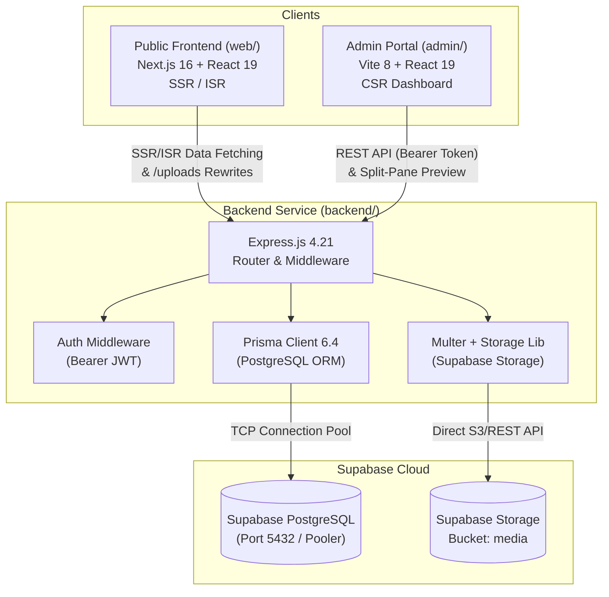
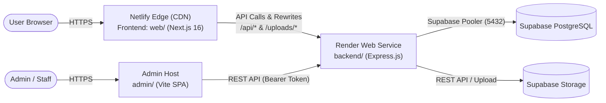

# Read-Only Deployment Audit Report: MahaPrisons

**Target Repository**: [https://github.com/samranganbhanuse/Mahaprisons.git](https://github.com/samranganbhanuse/Mahaprisons.git)  
**Branch**: `CMS-Build-New`  
**Date**: October 19, 2026  
**Audit Scope**: `web`, `backend`, `admin`, `web-legacy`, package manifests, Prisma configuration, route registration, authentication, storage, and Netlify compatibility.

---

## 1. Current Project Architecture

The MahaPrisons repository is organized as a poly-project monorepo (without root workspace tooling like Turborepo or npm workspaces). There is no root `package.json` or `netlify.toml`. Each subproject operates independently with its own `package.json` and `node_modules`:

```
MahaPrisons/
├── web/                 # Next.js 16 (App Router) + React 19 production public frontend
├── backend/             # Express.js 4.21 + Prisma ORM 6.4 + Supabase API server
├── admin/               # Vite 8 + React 19 + TypeScript CMS administrative dashboard
├── web-legacy/          # Legacy Vite 8 SPA frontend (deprecated, superseded by web/)
├── docker-compose.yml   # Local dev containers (PostgreSQL 16 on :5435, Redis 7 on :6379)
└── docs/                # Architecture specifications and implementation logs
```



---

## 2. Intended Production Frontend and Backend

### A. Production Frontend: `web/`
* **Intended Application**: `web/` is the official public application. It was rebuilt from the ground up to replace the legacy Vite Single Page Application (`web-legacy/`) using **Next.js 16.3.4 (App Router) + React 19.2.8** to satisfy GIGW 3.0 accessibility and search-crawler SEO requirements via Server-Side Rendering (SSR) and Incremental Static Regeneration (ISR).
* **Routes Implemented**:
  * Root Page: `web/src/app/(main)/page.tsx` (ISR with 60-second revalidation).
  * Catch-All Dynamic Route: `web/src/app/(main)/[...slug]/page.tsx` (Dynamic SSR via `PageRenderer`).
  * Live Preview: `web/src/app/preview/page.tsx` and `web/src/app/preview-revision/page.tsx`.
* **Folder Exclusion**:
  * `web-legacy/`: **Do NOT deploy.** This is the obsolete client-side Vite prototype and is completely superseded by `web/`.
  * `admin/`: Currently hosted as a separate static Vite SPA on Render (`https://mahaprisons-admin-panel.onrender.com`). It should either remain separate on Render or be deployed as a distinct Netlify site, but **must not** be combined into the public web application bundle.

### B. Production Backend: `backend/`
* Node.js + Express.js API (`backend/src/index.js`) backed by Prisma ORM and Supabase.
* Currently running on Render at `https://mahaprisons.onrender.com`.

---

## 3. Communication Patterns & Render References

### Current Communication Flow
1. **API URL Resolution**:
   * Defined in `web/src/utils/apiConfig.js`:
     ```javascript
     export const API_URL = process.env.NEXT_PUBLIC_API_URL || 
       (process.env.NODE_ENV === 'development' ? 'http://localhost:5000' : 'https://mahaprisons.onrender.com');
     ```
   * Next.js rewrites in `web/next.config.ts` proxies `/uploads/:path*` to `${API_URL}/uploads/:path*`.
2. **Server-Side Rendering (SSR/ISR)**:
   * During build and at runtime, Next.js server components in `web/src/app/(main)/layout.tsx` and `web/src/app/(main)/page.tsx` make HTTP GET requests to:
     * `${API_URL}/api/v1/menu`
     * `${API_URL}/api/v1/settings`
     * `${API_URL}/api/v1/pages/by-slug?slug=/`
3. **Existing Render References in Codebase**:
   * **Backend API**: `https://mahaprisons.onrender.com` referenced in `web/next.config.ts`, `web/src/utils/apiConfig.js`, and `admin/.env.production`.
   * **Admin Panel**: `https://mahaprisons-admin-panel.onrender.com` referenced in `web/src/components/AccessibilityToolbar.jsx` and `admin/vite.config.ts`.
   * **Public Frontend**: `https://mahaprisons-2qu2.onrender.com` referenced in `admin/src/config/api.ts` and `admin/.env.production`.

---

## 4. Deep Inspection: Express, Auth, Storage & Prisma

### A. Express Entry Point & Route Registration
* **Entry Point**: `backend/src/index.js`
* **Registered Endpoints**:
  * Health: `GET /api/health`
  * Auth: `/api/v1/auth` (`backend/src/routes/auth.js`)
  * Menu: `/api/v1/menu` (`backend/src/routes/menu.js`)
  * Settings: `/api/v1/settings` (`backend/src/routes/settings.js`)
  * Review / Maker-Checker: `/api/v1/review` (`backend/src/routes/review.js`)
  * Users & Roles: `/api/v1/users` (`backend/src/routes/users.js`)
  * Transliteration Proxy: `/api/v1/transliterate` (`backend/src/routes/transliterate.js`)
  * Translation Proxy: `/api/v1/translate` (`backend/src/routes/translate.js`)
  * Media Management: `/api/v1/media` (`backend/src/routes/media.js`)
  * Page Nodes & Blocks: `/api/v1/pages` (`backend/src/routes/pages.js`)

### B. Authentication Middleware & Cookie Behavior
* **Token Verification**: Handled by `authMiddleware` in `backend/src/middleware/auth.js`. It expects `Authorization: Bearer <token>` and verifies it using `jsonwebtoken` against `JWT_SECRET`.
* **Cookie Finding**: While the project documentation describes "JWT HTTP-Only Cookies", **the active code does NOT use HTTP-only cookies**:
  * `backend/src/routes/auth.js` returns the token directly in the JSON response body: `{ token, user }`.
  * `admin/src/context/AuthContext.tsx` stores this token in browser `localStorage` and attaches it via Axios default headers: `Authorization: Bearer <token>`.
  * No cookie parsing or cookie header extraction is active in Express.

### C. Media Upload Implementation
* Uses `multer.memoryStorage()` with a 5MB limit in `backend/src/routes/media.js`.
* When `STORAGE_MODE === 'supabase'`:
  * Files are streamed from the in-memory buffer directly to Supabase Storage via `backend/src/lib/storage.js`.
  * Storage path is `uploads/<timestamp>-<random>.<ext>` in bucket `media`.
  * Public URL is resolved via `supabase.storage.from(bucketName).getPublicUrl(filepath)`.
* **Top-Level Side Effect Alert**: Lines 13-16 in `backend/src/routes/media.js`:
  ```javascript
  const uploadDir = path.join(__dirname, '../../uploads');
  if (!fs.existsSync(uploadDir)) {
    fs.mkdirSync(uploadDir, { recursive: true });
  }
  ```
  On serverless platforms (Netlify Functions / AWS Lambda), the root filesystem is read-only. Executing `mkdirSync` at the top level causes an immediate `EROFS: read-only file system` fatal crash during cold start.

### D. Prisma Initialization
* Schema defined in `backend/prisma/schema.prisma`.
* **Engine Targets**: Does NOT specify `binaryTargets`. Defaults to `"native"`. To run on Netlify Functions (Amazon Linux/Lambda), it requires `binaryTargets = ["native", "rhel-openssl-3.0.x"]`.
* **Prisma Client Multi-Instantiations**:
  * Every single route file (`auth.js`, `media.js`, `menu.js`, `pages.js`, `review.js`, `settings.js`, `users.js`) invokes `const prisma = new PrismaClient()` independently.
  * In a serverless environment, creating 7 separate client instances per function container will rapidly exhaust Supabase's PostgreSQL connection limits. A shared singleton instance is required.

---

## 5. Repository Self-Containment Verification

The repository was verified via local production builds and syntax checks:
* `web/`: `npm run build` completed successfully (Exit Code 0). All routes (`/`, `/[...slug]`, `/preview`, etc.) compiled with Next.js Turbopack and TypeScript.
* `backend/`: `npx prisma generate` generated Prisma Client v6.19.3 successfully (Exit Code 0). All JavaScript files passed syntax verification (`node -c`).
* `admin/`: `npm run build` succeeded (Exit Code 0).
* **Conclusion**: The repository is **100% self-contained** and does not require files from any external local path.

---

## 6. Exact Deployment Blockers & Netlify Compatibility Risks

### Category A: Serverless Backend Compatibility Risks (Netlify Functions)
Adapting the existing Express backend into Netlify Functions introduces the following architectural blockers:

1. **Circular Dependency During Static Generation (Build-Time Chicken-and-Egg)**:
   * Next.js App Router in `web/` executes Server-Side Pre-rendering (`getStaticProps` / ISR) during `next build`.
   * These server components must fetch menu, settings, and pages from `${API_URL}` during the build.
   * If the backend is deployed as Netlify Functions inside the same site, **the functions are not live or running while the Netlify build container runs `next build`**. The build will fail with connection errors or render blank pages.
2. **Serverless Payload Limit (6MB Gateway Constraint)**:
   * Netlify Functions enforce a hard 6MB limit on HTTP request bodies (including base64 encoding overhead).
   * File uploads in `backend/src/routes/media.js` exceeding ~4.5MB will trigger a `413 Payload Too Large` from Netlify before reaching Express.
3. **Execution Timeout (10s Default)**:
   * Netlify Functions have a default 10-second timeout. Heavy operations such as external URL image import via Axios (`media.js:155`) or bulk menu tree database transactions risk premature termination.
4. **Database Connection Pool Exhaustion**:
   * Netlify Functions scale horizontally by spawning new containers. Supabase free/micro instances allow limited concurrent direct connections. Without PgBouncer transaction pooling (`?pgbouncer=true&connection_limit=1`) and a singleton Prisma client, serverless functions can quickly saturate the database.
5. **Read-Only Filesystem Collision**:
   * `backend/src/routes/media.js:15` unconditionally calls `fs.mkdirSync` on startup, crashing in serverless.

### Category B: Monorepo & Configuration Blockers
1. **Missing Netlify Configuration**:
   * There is no `netlify.toml` declaring the build directory, package manager, and plugins.
2. **Invalid `.env.production` in Backend**:
   * `backend/.env.production` contains a raw connection string without the `DATABASE_URL=` variable key.
3. **Hardcoded Localhost in Review URLs**:
   * `backend/src/routes/review.js:23-45` hardcodes `http://localhost:3000` and `http://localhost:5173` into generated preview links instead of reading from environment variables.

---

## 7. Recommended Deployment Configuration

In accordance with project guidelines:
> *"If serverless deployment requires significant changes or cannot reliably support existing functionality, stop and recommend the least disruptive alternative: Netlify frontend with a separate Node.js backend host."*

### Recommendation: Decoupled Architecture (Least Disruptive, Production-Grade)



1. **Deploy Frontend to Netlify (`web/`)**:
   * Connect Netlify to the GitHub repository.
   * Set Base directory: `web`
   * Build command: `npm run build`
   * Publish directory: `.next`
   * Plugin: `@netlify/plugin-nextjs`
   * Environment Variable:
     * `NEXT_PUBLIC_API_URL = https://mahaprisons.onrender.com`
2. **Retain Backend on Render (`backend/`)**:
   * Maintain the long-running Express server on Render (`https://mahaprisons.onrender.com`).
   * Eliminates all serverless cold-start penalties, connection pool exhaustion, 6MB payload limits, and build-time circular dependencies.
   * Preserves local Docker compatibility and current API contracts without breaking changes.
3. **Admin Dashboard (`admin/`)**:
   * Retain on Render (`https://mahaprisons-admin-panel.onrender.com`) or deploy as a secondary Netlify static site.

---

## 8. Required File Changes (Upon Approval)

If you approve this recommended decoupled configuration, the following changes will be executed:

| Target File | Action | Purpose |
| :--- | :--- | :--- |
| `netlify.toml` | Create | Configure Netlify build pipeline for `web` with Next.js plugin and Node runtime. |
| `web/next.config.ts` | Update | Ensure image domains and rewrites properly proxy both `/uploads` and dynamic backend assets. |
| `backend/src/routes/review.js` | Patch | Replace hardcoded `localhost:3000` and `localhost:5173` preview URLs with `FRONTEND_URL` and `ADMIN_URL` environment variables. |
| `backend/src/lib/prisma.js` | Create | Centralize PrismaClient instantiation into a shared singleton to protect database connection pools. |
| `backend/src/routes/*.js` | Update | Import the shared Prisma singleton across all route files. |
| `backend/src/routes/media.js` | Guard | Wrap `fs.mkdirSync` inside `STORAGE_MODE !== 'supabase'` check so it never executes against read-only filesystems. |

---

## 9. Netlify Environment Variables Checklist

### Frontend (`web/` on Netlify)
| Variable Name | Example / Target Value | Description |
| :--- | :--- | :--- |
| `NEXT_PUBLIC_API_URL` | `https://mahaprisons.onrender.com` | Backend API base endpoint |
| `NODE_VERSION` | `20` | Node.js runtime version for build |

### Backend (`backend/` on Render or dedicated Node host)
| Variable Name | Example / Target Value | Description |
| :--- | :--- | :--- |
| `PORT` | `5000` | HTTP listen port |
| `DATABASE_URL` | `postgresql://postgres...pooler.supabase.com:5432/postgres` | Supabase PostgreSQL Connection Pooler URL |
| `STORAGE_MODE` | `supabase` | Direct uploads to Supabase Storage |
| `SUPABASE_URL` | `https://yqljyiqtbzehecfdfxaz.supabase.co` | Supabase project URL |
| `SUPABASE_SERVICE_ROLE_KEY` | `sb_secret_...` | Supabase service role key |
| `SUPABASE_STORAGE_BUCKET` | `media` | Supabase Storage bucket name |
| `JWT_SECRET` | `<secure_random_string>` | Signing key for JWT auth tokens |
| `FRONTEND_URL` | `https://<your-site>.netlify.app` | Netlify frontend URL for review links |
| `ADMIN_URL` | `https://mahaprisons-admin-panel.onrender.com` | Admin dashboard URL |
