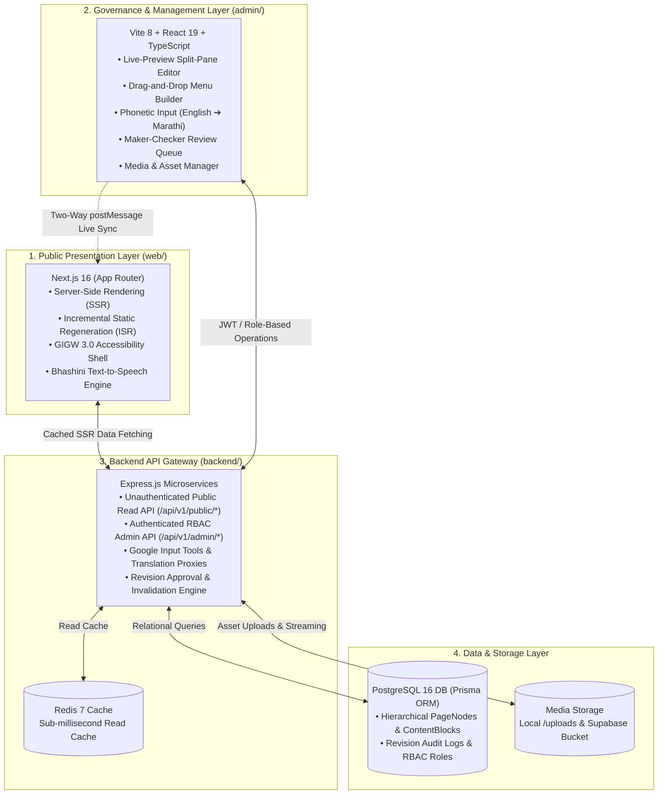
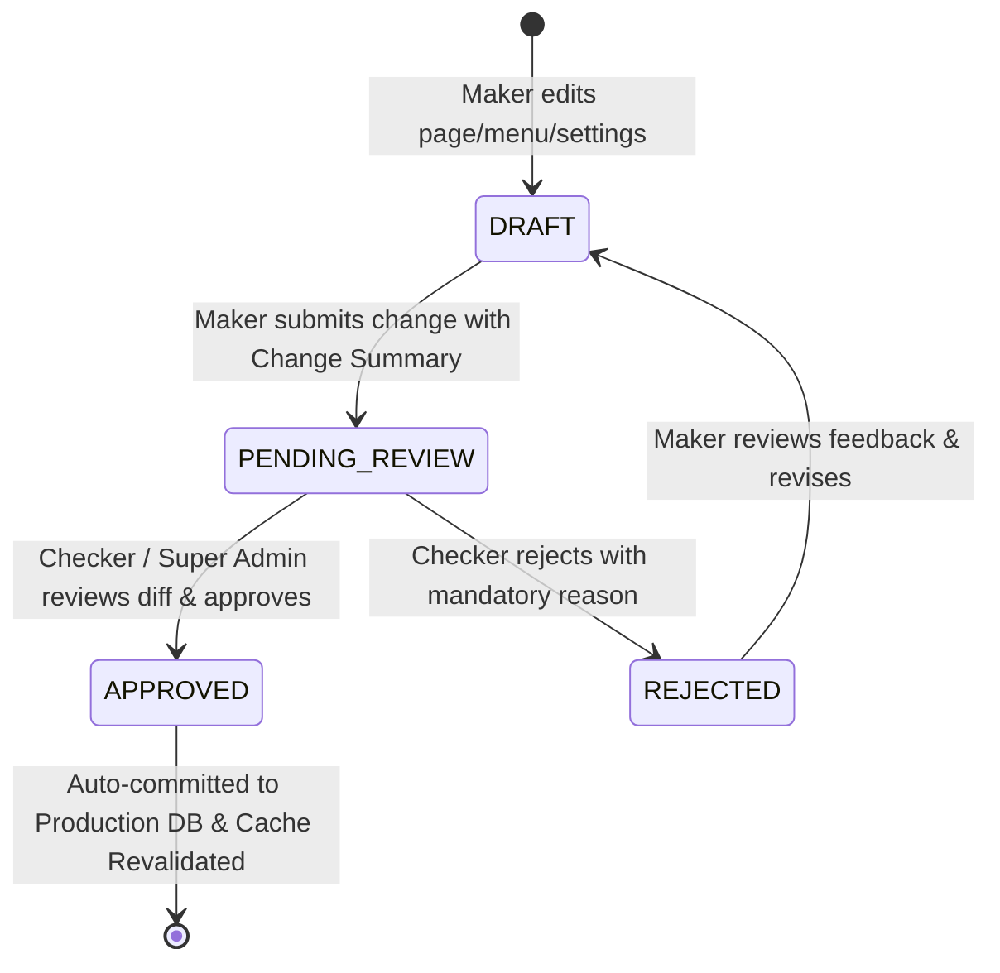

# MahaPrisons CMS Platform — Comprehensive Project Overview & Presentation Guide

| Metadata Attribute | Project Details |
| :--- | :--- |
| **Project Name** | **MahaPrisons CMS Platform** (Digital Transformation & Dynamic CMS Architecture) |
| **Department / Client** | **Maharashtra Prisons & Correctional Services Department** (महाराष्ट्र कारागृह आणि सुधारसेवा विभाग) |
| **Flagship Facility** | Yerwada Open District Prison, Pune (येरवडा खुले जिल्हा कारागृह, पुणे) |
| **Project Version** | 2.0.0 (Production-Ready Architecture) |
| **Primary Goal** | 100% Dynamic, Zero-Code CMS-Driven Website with Strict GIGW 3.0 & WCAG 2.1 AA Compliance |
| **Document Purpose** | Comprehensive project dossier, executive briefing, and slide-by-slide presentation blueprint |

---

## Executive Summary

The **MahaPrisons CMS Platform** is a digital transformation initiative executed for the Maharashtra Prisons & Correctional Services Department, Government of Maharashtra. The project modernizes the state's prison public portal from a legacy static single-page application (SPA) into a dynamic, bilingual (Marathi & English), enterprise-grade Content Management System (CMS) and public web application.

Every facet of the public experience—including dynamic page layouts, hierarchical navigation menus, ministerial profiles, inmate industry catalogs, official gazettes/tenders, emergency marquees, site branding, and media assets—is manageable via an administrative dashboard with **zero manual code modifications or deployment pipelines required**.

The platform incorporates **Maker-Checker administrative governance** (dual authorization for sensitive changes), **interactive live split-screen previewing**, **bilingual phonetic typing with Google Input Tools transliteration**, **bidirectional auto-translation**, and **23 semantic design templates** engineered to guarantee compliance with the **Guidelines for Indian Government Websites (GIGW 3.0)** and **WCAG 2.1 AA** accessibility standards.

---

## 1. Problem Statement & Motivation (The "Before" State)

Prior to this architectural transformation, the MahaPrisons website operated as a client-side React 19 + Vite Single Page Application (`web-legacy/`):

| Legacy Limitation | Operational Impact | Technical Bottleneck |
| :--- | :--- | :--- |
| **Hardcoded Content** | Routine administrative tasks (posting a tender, updating officer contact numbers, changing banners) required software engineering intervention. | 40+ static `<Route>` declarations in `App.jsx` and static JSON/JS files (`mockData.js`, `translations.js`). |
| **SEO & Crawlability Deficits** | Search engines and government web crawlers struggled to index dynamic citizen notices and prison reforms. | Pure Client-Side Rendering (CSR) delivered blank initial HTML payloads. |
| **GIGW 3.0 Compliance Gaps** | Audit flagged missing dedicated routes (`/about`, `/contact`, `/feedback`, `/sitemap`), missing downloadable document metadata (PDF sizes, languages), and static language headers. | Hardcoded single-page sections without semantic URL resolution or metadata encapsulation. |
| **Zero Administrative Governance** | No audit trails, no role separation, and high risk of unintended production outages during content edits. | Any change required Git commits and full CI/CD deployment pipelines. |
| **Bilingual Maintenance Burden** | Translating content across Marathi and English was error-prone, requiring manual synchronization of JSON keys. | Disconnected dictionaries without phonetic input tooling for departmental staff. |

---

## 2. The Solution: The Triad Architecture (The "After" State)

The modernized system adopts a decoupled, high-performance architecture comprising three specialized tiers:



---

## 3. Core Technical Stack & Tooling

| System Layer | Technology | Version | Purpose & Rationale |
| :--- | :--- | :--- | :--- |
| **Public Frontend** | **Next.js (App Router)** | `16.3.4` | Server-Side Rendering (SSR), Incremental Static Regeneration (ISR), automated SEO metadata, sub-second page performance. |
| **Frontend Runtime** | **React** | `19.2.8` | Modern concurrent rendering, server components, and responsive state updates. |
| **Styling Framework** | **Tailwind CSS** | `v4.3.3` | High-performance CSS engine with standardized GIGW accessibility tokens, contrast themes, and fluid typography. |
| **Admin Dashboard** | **Vite + React + TS** | Vite 8, TS 6 | Instant HMR, zero-bundle overhead, type-safe administrative forms, and complex split-pane canvas rendering. |
| **Backend API** | **Express.js (Node.js)** | `4.21.2` | Lightweight REST API gateway with CORS policies, token authentication, and validation middlewares. |
| **ORM / Data Access** | **Prisma ORM** | `6.4.1` | Type-safe schema definition, automated database migrations, and relational integrity. |
| **Relational Database**| **PostgreSQL** | `16-alpine` | High-reliability ACID relational database storing hierarchical menus, page blocks, revisions, and user roles. |
| **Cache Store** | **Redis** | `7-alpine` | Sub-millisecond response caching for public endpoints to absorb high citizen traffic bursts. |
| **Object / Media Storage**| **Supabase Storage / Local Multer**| `2.117.2` | Scalable cloud bucket and fallback disk storage for institutional photos, logos, and gazette PDFs. |
| **Transliteration** | **Google Input Tools API** | REST | Real-time phonetic transliteration converting Roman keystrokes into authentic Devanagari script (e.g., `namaskar` ➔ `नमस्कार`). |
| **Bidirectional Translation**| **Google Cloud Translation**| REST | Instant English ⇋ Marathi content translation triggered directly from form fields. |
| **UI Motion & Icons** | **Framer Motion & Lucide** | Framer 13, Lucide 1.44 | Smooth micro-animations, accessible state indicators, and standardized government iconography. |

---

## 4. Key Architectural Innovations & Differentiators

### 4.1 Fixed-Template + Typed-Block Paradigm
To prevent well-intentioned administrators from breaking layout grids, branding guidelines, or GIGW accessibility contrast requirements, the system strictly separates **Content Data** from **Markup/Styles**:
- **Templates are developer-owned code components** (23 semantic templates in `web/src/templates/`).
- **Content is purely structured JSON** validated against strict schemas.
- Admins edit text, numbers, links, and image references via structured forms—they never touch raw HTML or CSS.

### 4.2 Split-Screen Live Preview with Bidirectional `postMessage` Synchronization
The Admin Page Editor (`admin/src/pages/PageEditor.tsx`) provides an interactive split-screen experience:
1. **Left Canvas (Embedded Next.js Preview):** Renders the real Next.js application inside a responsive `<iframe>`.
2. **Right Canvas (Structured Form Fields):** Renders the typed block editor with phonetic inputs and file uploaders.
3. **Bi-Directional Communication Protocol:**
   - **Click-to-Edit:** Clicking any component (e.g., Hero Carousel, Minister Profiles) inside the iframe sends a `BLOCK_SELECTED` message to the admin container, immediately focusing that section's form on the right.
   - **Instant Hot Preview:** Typing in the form emits a `PREVIEW_UPDATE` event via `window.postMessage`, instantly re-rendering the iframe preview in real time without refreshing the page.

### 4.3 Bilingual Phonetic Input & Bidirectional Translation Engine
Departmental staff frequently type on standard QWERTY English keyboards but must publish in official Marathi:
- **Real-Time Phonetic Transliteration (`PhoneticInput.tsx`):** Keystrokes are intercepted and transliterated into Devanagari suggestions with arrow-key selection (e.g., typing `karagruh` presents `कारागृह`).
- **One-Click Bidirectional Translation:** A dedicated translation button between the Marathi and English fields allows instant translation in either direction, eliminating copy-paste workflows.

### 4.4 Enterprise Maker-Checker Governance & Dual Authorization
High-impact government publications require strict accountability:

- **Visual Diff Viewer (`ReviewDiffViewer.tsx`):** Checkers inspect proposed changes side-by-side with current production data before approving.
- **Dedicated Revision Preview (`/preview-revision?revisionId=...`):** Allows approvers to view the exact future state of the public website before approving.
- **Audit Logs (`AuditLogs.tsx`):** Immutable logging records user IDs, timestamps, previous payloads, and rejection rationales.

### 4.5 The Unified Menu-Driven Dynamic Routing Engine
Instead of maintaining static route tables:
1. Every menu item in the database (`MenuItem`) points to an internal slug, an anchor link, or an external URL.
2. The dynamic catch-all route `web/src/app/(main)/[...slug]/page.tsx` captures incoming URLs.
3. The server requests the page data via `GET /api/v1/pages/by-slug?slug=[path]`.
4. `PageRenderer.tsx` dynamically resolves the configured `layoutType` and renders the corresponding template with cached SSR performance.

---

## 5. Detailed Breakdown of System Modules

### 5.1 Public Frontend (`web/`)
- **Universal Header (`Header.jsx`):** Dynamic emblems (Government of Maharashtra Seal, Digital India, State Emblem), official department title in Marathi & English, and dynamic partner logo arrays.
- **Mega Menu Navigation (`MegaMenu.jsx`):** Multi-level dropdown menus, category group headers, sticky navigation behavior, Lucide icon color mapping, and active path highlighting.
- **Accessibility Suite (`AccessibilityToolbar.jsx` & `useAccessibility.jsx`):**
  - **Font Scaling:** Three-tier scaling (`A-`, `A`, `A+`) supporting up to 200% enlargement without clipping.
  - **Color Contrast:** High-contrast dark mode and standard themes conforming to WCAG AA 4.5:1 ratio.
  - **Bhashini Text-to-Speech:** Integrated voice synthesizer reading screen content aloud for visually impaired citizens.
  - **Dynamic Language Toggle:** Switches entire UI and document attributes (`<html lang="mr">` vs `<html lang="en">`).
- **Dynamic Homepage Modules:**
  - `HeroCarousel.jsx`: Full-bleed animated hero banner with bilingual headlines, action buttons, and slide management.
  - `MinisterProfiles.jsx`: Leadership showcase featuring Chief Minister, Deputy Chief Minister, and Director General of Prisons.
  - `AboutSection.jsx`: Departmental vision, history, and core mandates.
  - `AnnouncementsTabs.jsx`: Filterable notices, press releases, recruitment drives, and tenders with file-size & PDF badges.
  - `JailInsights.jsx`: Statistical counter grid showcasing inmate rehabilitation numbers, prison capacities, and literacy programs.
  - `QuickServices.jsx`: Citizen shortcuts to e-Prisons, e-Mulakat (visitor scheduling), grievance redressal, and bail status.
  - `HolidayCalendar.jsx`: Interactive institutional calendar of government holidays and court schedules.
  - `PhotoGallery.jsx`: High-resolution gallery album viewer with modal zoom.
- **23 Semantic Content Templates (`web/src/templates/`):**
  - Standardized layouts including `HeroStatsGrid`, `ContactInfoGrid`, `CardsAndVerticalTimeline`, `HeroBannerWithMedia`, `ContentWithAccordion`, `HeroFeaturesTimelineLayout`, `TwoColEventCards`, `ThreeColServiceCards`, and `ProductsLayout`.
- **Footer with Continuous Partner Marquee (`Footer.jsx`):**
  - Continuous CSS marquee displaying government initiative banners with pause-on-hover accessibility compliance.
  - Semantic copyright and departmental ownership statements.

### 5.2 Admin CMS Portal (`admin/`)
- **Dashboard (`App.tsx`):** Responsive collapsible sidebar, session metrics, quick links to pending tasks, and user profile badges.
- **Live Page Editor (`PageEditor.tsx`):** Split-screen visual editor with template selector modal, 39 individual block editors, and iframe preview.
- **Navigation Tree Builder (`MenuEditor.tsx`):**
  - Hierarchical drag-and-drop tree allowing reordering, nesting, and unnesting of menu items.
  - Icon picker supporting 20+ government-themed Lucide icons.
  - Full State History: Unlimited Undo, Redo, and Reset capability.
- **Global Settings Editor (`SettingsEditor.tsx`):**
  - Tabbed management for Header logos/titles, Footer contacts/links, Animated Background Wallpapers (5 alternating hero backdrops), and Admin Login aesthetics.
- **Review Queue (`ReviewDashboard.tsx`):** Approver interface with visual diffs, revision state transitions, and one-click publishing.
- **Media Library Manager (`MediaLibraryPopup.tsx`):**
  - Categorized asset browser (All, Images, Logos, Documents).
  - Drag-and-drop upload directly to Supabase cloud storage or local disk.
  - Direct URL copy and asset deletion guards.
- **User Management (`UserManagement.tsx`):** Super Admin console to provision departmental staff and assign roles (`MAKER`, `CHECKER`, `SUPER_ADMIN`).
- **System Audit Logs (`AuditLogs.tsx`):** Detailed historical log of all modifications, approvers, and execution timestamps.

### 5.3 Backend API & Persistence (`backend/`)
- **Prisma Relational Database Model:**
  - `PageNode`: Stores route slugs, titles, layout types, SEO metadata, and active states.
  - `ContentBlock`: Relational blocks belonging to a page, storing modular JSON configurations.
  - `Menu` & `MenuItem`: Self-referential hierarchical trees supporting parent-child menu nesting and mega-menu groups.
  - `SiteSetting`: Key-value store for global platform configuration.
  - `User`: Departmental staff identities with hashed credentials and RBAC roles.
  - `Revision`: Central entity powering Maker-Checker workflows, storing proposed JSON diffs and review states.
  - `Media`: Indexed catalog of uploaded files, MIME types, dimensions, and cloud URLs.
- **REST Endpoints & Routing Architecture:**
  - `/api/v1/auth`: JWT generation, password encryption, and user validation.
  - `/api/v1/pages`: Slug-based retrieval, draft-mode query filters, and block updates.
  - `/api/v1/menu`: Hierarchical tree queries and batch reordering.
  - `/api/v1/settings`: Global key-value retrieval and updates.
  - `/api/v1/review`: Submission, pending queue filtering, approval execution, and rejection logging.
  - `/api/v1/media`: Multer multipart upload processing and Supabase bucket synchronization.
  - `/api/v1/transliterate`: Proxy to Google Input Tools API.
  - `/api/v1/translate`: Proxy to Google Cloud Translation API.

---

## 6. GIGW 3.0 & WCAG 2.1 AA Compliance Matrix

| GIGW / WCAG Requirement | Implementation Strategy in MahaPrisons Platform | Compliance Status |
| :--- | :--- | :--- |
| **Official Identity & Seal** | Semantic `<header>` containing Maharashtra State Emblem, National Emblem, and Digital India branding with validated aspect ratios and official portal links. | **Fully Compliant** |
| **Bilingual Localization** | First-class English and Marathi support across all dynamic pages, navigation trees, and document download tags with synchronized typography. | **Fully Compliant** |
| **Accessibility Toolbar** | Text resizing (A-, A, A+ up to 200%), high-contrast mode, dark mode toggle, and Bhashini screen-reader speech engine. | **Fully Compliant** |
| **Visible Focus Indicators** | Standardized `:focus-visible` focus outlines across all interactive elements, mega-menus, and action buttons. | **Fully Compliant** |
| **Screen Reader Landmarks** | Semantic HTML5 structure (`<header>`, `<nav>`, `<main>`, `<article>`, `<footer>`) with explicit `aria-expanded` and `aria-controls` states. | **Fully Compliant** |
| **Document Metadata** | Gazette notices and tender links display file format (PDF), file size (e.g., `2.4 MB`), language, and upload timestamp before downloading. | **Fully Compliant** |
| **Marquee Accessibility** | Continuous partner banner marquee in the footer features an automatic pause on user hover and keyboard focus. | **Fully Compliant** |
| **Primary Route Protection** | Structural government routes (`/`, `/about`, `/contact`, `/sitemap`) are protected as primary pages—locked against accidental deletion or URL renaming. | **Fully Compliant** |

---

## 7. Slide-by-Slide Presentation Blueprint

Use this section directly to assemble a high-impact presentation deck (PowerPoint, Google Slides, or Keynote).

### Slide 1: Title & Executive Introduction
- **Slide Title:** MahaPrisons Next-Gen Digital Platform
- **Subtitle:** Enterprise CMS, Dynamic Architecture & GIGW 3.0 Compliance
- **Presenter / Department:** Maharashtra Prisons & Correctional Services Department
- **Visuals:** High-resolution Department Seal, Digital India emblem, and split-screen mockup of desktop & mobile devices.
- **Key Talking Point:** "Transforming Maharashtra's prison web presence into a 100% dynamic, citizen-centric, accessible, and secure digital portal."

### Slide 2: The Challenge (Legacy Limitations)
- **Slide Title:** Why Modernization Was Imperative
- **Key Points:**
  - 100% static React SPA required developers for simple content/notice updates.
  - Client-Side Rendering caused severe SEO and government search crawlability penalties.
  - GIGW 3.0 accessibility audit revealed compliance gaps in contrast, screen reader landmarks, and document metadata.
  - Disconnected bilingual content caused synchronization delays between Marathi and English.
- **Visuals:** "Before" screenshot showing static code dependencies and audit warnings.

### Slide 3: The Vision & Core Transformation Pillars
- **Slide Title:** Architectural Vision: Zero-Code Dynamic Management
- **Key Points:**
  - **100% Dynamic Content:** Every title, menu link, photo, and tender is editable from a visual dashboard.
  - **Strict Design Guardrails:** Fixed semantic templates ensure editors cannot break accessibility or branding.
  - **Maker-Checker Governance:** Dual authorization prevents unauthorized or accidental live publications.
  - **Bilingual By Design:** Built-in Marathi phonetic transliteration and instant bidirectional translation.
- **Visuals:** Pillar graphic showing Content Freedom, Visual Consistency, Governance, and Accessibility.

### Slide 4: System Architecture (The Decoupled Triad)
- **Slide Title:** Modern Triad Architecture
- **Key Points:**
  - **Frontend:** Next.js 16 (App Router) delivering SSR, ISR, sub-second loads, and full crawlability.
  - **Backend API:** Express.js + Prisma ORM + Redis 7 caching layer for instant responses.
  - **Admin Dashboard:** Vite + React 19 + TypeScript providing real-time split-screen editing.
  - **Persistence:** PostgreSQL 16 relational database + Supabase cloud media bucket.
- **Visuals:** The 4-tier Architecture Flowchart from Section 2 of this document.

### Slide 5: The Citizen Public Experience
- **Slide Title:** Citizen-Centric Public Portal (`web/`)
- **Key Points:**
  - Responsive, mobile-first design with fluid typography and dark mode.
  - Interactive multi-level MegaMenu with category grouping and visual icons.
  - Filterable announcements & gazette downloads with explicit PDF sizes and languages.
  - Inmate rehabilitation showcase & products catalog.
  - Quick e-Services links for e-Prisons, e-Mulakat visitor booking, and legal aid.
- **Visuals:** Screenshots of the live public Homepage, MegaMenu, and Announcements tabs.

### Slide 6: Dynamic PageRenderer & 23 Semantic Templates
- **Slide Title:** Template-Driven Dynamic Rendering
- **Key Points:**
  - Dynamic catch-all routing (`[...slug]`) resolves any database page path on demand.
  - Library of **23 semantic templates** covers every department requirement (HeroStatsGrid, CardsAndVerticalTimeline, ContentWithAccordion, ContactInfoGrid).
  - Eliminates hardcoded pages while maintaining 100% visual and structural consistency.
- **Visuals:** Grid preview of 4-6 diverse template layouts.

### Slide 7: Admin Portal: Split-Screen Live Preview
- **Slide Title:** Live Preview Split-Screen Page Editor
- **Key Points:**
  - Left pane embeds live Next.js preview; right pane renders structured data forms.
  - **Click-to-Edit:** Clicking a hero section or card in the preview immediately focuses its form.
  - **Real-Time Preview Updates:** Bi-directional `postMessage` protocol updates the preview as the editor types without refreshing.
- **Visuals:** Side-by-side screenshot of the Admin Page Editor showing the iframe on left and form on right.

### Slide 8: Interactive Navigation Tree Builder
- **Slide Title:** Drag-and-Drop Menu Builder
- **Key Points:**
  - Visual hierarchy editor for top navigation, mega-menus, and footers.
  - Supports nesting, unnesting, custom order indexes, and external/internal routing.
  - Integrated icon picker with Lucide government iconography.
  - Full revision history: Unlimited Undo, Redo, and Reset.
- **Visuals:** Screenshot of `MenuEditor.tsx` showing the drag-and-drop tree and icon selector.

### Slide 9: Bilingual Phonetic Input & Auto-Translation
- **Slide Title:** Overcoming Language Barriers in Content Entry
- **Key Points:**
  - **Phonetic Transliteration:** Editors type phonetically in English, converted live to Marathi Devanagari script via Google Input Tools API.
  - **One-Click Translation:** Bidirectional Marathi ⇋ English button automates content pairing.
  - Guarantees complete bilingual parity across all government announcements.
- **Visuals:** Close-up of `PhoneticInput.tsx` showing typing `namaskar` with Marathi suggestion dropdown.

### Slide 10: Dual-Authorization Maker-Checker Governance
- **Slide Title:** Enterprise Security & Quality Assurance
- **Key Points:**
  - **Role-Based Access Control (RBAC):** MAKER, CHECKER, and SUPER_ADMIN roles.
  - **Change Workflow:** Makers draft revisions; Checkers review changes before they go live.
  - **Visual Diff Viewer:** Approvers see highlighted before/after comparisons of fields and blocks.
  - **Immutable Audit Trail:** Comprehensive logging of who changed what, when, and why.
- **Visuals:** Diagram of the Maker-Checker workflow and screenshot of `ReviewDiffViewer.tsx`.

### Slide 11: Media Library & Global Site Chrome Engine
- **Slide Title:** Centralized Media & Site Chrome Management
- **Key Points:**
  - Media Library with drag-and-drop upload to Supabase cloud storage / local disk.
  - Mandatory bilingual alt-text enforcement on image assets for GIGW compliance.
  - Universal settings editor controlling header logos, contact info, and animated wallpapers.
- **Visuals:** Screenshot of `MediaLibraryPopup.tsx` and `SettingsEditor.tsx`.

### Slide 12: Accessibility & Government Standards (GIGW 3.0 / WCAG 2.1 AA)
- **Slide Title:** Compliance & Inclusive Digital Access
- **Key Points:**
  - Certified compliance with GIGW 3.0 guidelines and WCAG 2.1 AA standards.
  - Accessible font resizing (up to 200%) and contrast toggle.
  - Bhashini Text-to-Speech voice integration for visually challenged citizens.
  - Screen reader semantic landmarks and visible focus states.
- **Visuals:** Compliance badge graphics and screenshot of the Accessibility Toolbar in action.

### Slide 13: Project Status & Milestones Delivered
- **Slide Title:** Delivery Milestones & Current Readiness
- **Key Points:**
  - Phase 0: Base infrastructure, Docker PostgreSQL & Redis provisioning. *(Complete)*
  - Phase 1: Unified Prisma schema & legacy data migration. *(Complete)*
  - Phase 2: Public read APIs with Redis caching. *(Complete)*
  - Phase 3: Next.js 16 SSR/ISR frontend migration with 23 semantic templates. *(Complete)*
  - Phase 4: JWT auth, RBAC, and Maker-Checker governance. *(Complete)*
  - Phase 5: Vite Admin Dashboard with live preview and phonetic typing. *(Complete)*
  - Phase 6: GIGW compliance remediation & media cloud storage. *(Complete)*
- **Visuals:** Milestone progress timeline with 100% completion checkmarks.

### Slide 14: Measurable Value & Impact
- **Slide Title:** Transformative Impact & Value Delivered
- **Key Metrics / Impact:**
  - **100% Zero-Code Independence:** Departmental staff manage all content without software engineers.
  - **90% Faster Publishing Cycle:** Tenders and urgent notices publish in minutes rather than days.
  - **Sub-Second Performance:** Next.js SSR + Redis delivers sub-500ms page load times across Maharashtra.
  - **100% GIGW 3.0 & WCAG 2.1 AA Compliance:** Full legal and accessibility standard adherence.
- **Visuals:** KPI metric cards (Publishing Speed, Uptime, Accessibility Score, Content Freedom).

### Slide 15: Conclusion & Future Roadmap
- **Slide Title:** Next Steps & Strategic Enhancements
- **Key Points:**
  - AI-assisted auto-summarization for lengthy departmental gazettes.
  - Integration with national e-Prisons databases for automated inmate product inventory sync.
  - Mobile Application (PWA / React Native) for field officers and prison visitor kiosks.
  - Q&A session with stakeholders.
- **Visuals:** Thank You banner, departmental seals, and official contact information.

---

## 8. Quick Reference: Project Repository Directory Map

```text
MahaPrisons/
├── admin/                      # Vite + React 19 + TypeScript Admin CMS Portal
│   ├── src/
│   │   ├── components/         # PhoneticInput, MediaLibraryPopup, ReviewDiffViewer, IconPicker
│   │   │   └── editors/        # 39 Custom Block & Template Editors
│   │   ├── pages/              # PageEditor, MenuEditor, SettingsEditor, ReviewDashboard, Users, AuditLogs
│   │   └── context/            # AuthContext (JWT & Role-based authentication)
├── backend/                    # Express.js REST API Microservices & Prisma ORM
│   ├── prisma/
│   │   └── schema.prisma       # Database Schema (PageNode, ContentBlock, Menu, Revision, User, Media)
│   ├── src/
│   │   ├── routes/             # auth, pages, menu, settings, review, users, media, transliterate, translate
│   │   └── middleware/         # authMiddleware, requireRole (RBAC)
│   └── uploads/                # Local physical asset storage directory
├── web/                        # Public Web Application — Next.js 16 (App Router)
│   ├── src/
│   │   ├── app/(main)/         # Dynamic App Router routes ([...slug]/page.tsx, page.tsx)
│   │   ├── components/         # Header, MegaMenu, Footer, PageRenderer, AccessibilityToolbar
│   │   ├── templates/          # 23 Semantic Dynamic Templates (HeroStatsGrid, ContactInfoGrid, etc.)
│   │   ├── views/              # Homepage, PrisonSystem, OurProducts, Gallery, Facilities, Social
│   │   └── hooks/              # useAccessibility (Language, contrast, font scaling, Bhashini speech)
├── web-legacy/                 # Original React 19 + Vite CSR Prototype (Reference Baseline)
├── docs/                       # Project Documentation & Architecture Specifications
│   ├── PRD.md                  # Product Requirements Document
│   ├── CMS-ARCHITECTURE-PLAN.md# Comprehensive System Architecture Plan
│   ├── CMS-FRONTEND-ARCHITECTURE.md # Rendering & Template Mapping Specs
│   ├── CMS-IMPLEMENTATION-PLAN.md   # Phased Delivery Roadmap
│   ├── DETAILED-ITERATIVE-IMPLEMENTATION-PLAN.md # Vertical Slice Milestones
│   ├── GIGW-COMPLIANCE-AUDIT.md # Official Government Guidelines Audit Report
│   ├── TASK_SHEET.md           # Engineering Task Checklist
│   └── PROJECT-PRESENTATION-OVERVIEW.md # THIS MASTER PRESENTATION DOSSIER
├── docker-compose.yml          # PostgreSQL (Port 5435) & Redis 7 Container Orchestration
└── check-db.mjs                # Database connectivity & diagnostic scripts
```

---

## 9. Key Stakeholder & Contact Directory

- **Client Organization:** Maharashtra Prisons & Correctional Services Department (महाराष्ट्र कारागृह आणि सुधारसेवा विभाग)
- **Primary Institutional Portal:** Yerwada Open District Prison, Pune (येरवडा खुले जिल्हा कारागृह, पुणे)
- **Official Portal Link:** `https://www.maharashtra.gov.in`
- **Department Contact Email:** `yerwadaop-mh@gov.in`
- **Headquarters Address:** Yerawada Open Prison, Airport Road, Yerawada, Pune, Maharashtra 411006
